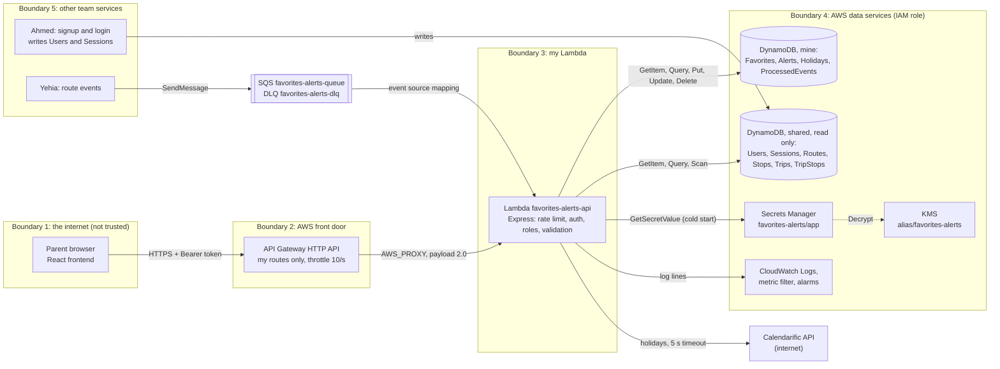

# Threat model: Favorites & Alerts service

Owner: Ali Mohsen (246090). Team 14, 26CSCN29H.
Method: STRIDE. Every control and test below is in this repo and was really run.

## 1. The system

Parents use the shared React frontend. Two of its pages are mine: My stops and Alerts.

- **API Gateway (HTTP API)** `favorites-alerts-http-api` is the only way in. It has only my
  routes, and stage throttling of 10 requests a second with a burst of 20.
- **Lambda** `favorites-alerts-api` runs Express (`app.js` through `lambda.js`). The same
  function also reads my SQS queue.
- **DynamoDB.** My tables (read and write): `Favorites`, `Alerts`, `Holidays`,
  `ProcessedEvents`. Shared tables (read only): `Users`, `Sessions`, `Routes`, `Stops`,
  `Trips`, `TripStops`.
- **SQS** `favorites-alerts-queue` with the dead-letter queue `favorites-alerts-dlq`
  (a message moves there after 3 failed tries).
- **Secrets Manager** `favorites-alerts/app` holds the Calendarific key and `RATE_LIMIT_MAX`.
- **KMS** key `alias/favorites-alerts` (rotation on) encrypts the secret and my 4 tables.
- **CloudWatch**: the Lambda log group, the metric filter `favorites-alerts-security-denied`
  and 3 alarms.

Where the other services connect:

- **Ahmed** owns signup and login. His service writes `Users` and `Sessions`. My
  `middleware/auth.js` only reads them: it looks up the SHA-256 hash of the Bearer token.
- **Yehia** sends route events (`trip.cancelled`, `trip.created`) to my SQS queue with
  `SendMessage`. My Lambda turns them into alerts for every parent who saved the route.

## 2. Data flow and trust boundaries

Each dashed box is a trust boundary. Data that crosses a boundary is checked.

## 3. STRIDE table

L = Low, M = Medium, H = High. "Likelihood / Impact" is before the control.

| ID | STRIDE | What can go wrong | Asset | Likelihood / Impact | Control in my code or infra | Test that proves it | Risk left |
|---|---|---|---|---|---|---|---|
| T1 | Spoofing | Someone uses a stolen, guessed or expired token to act as a parent. | Parent accounts, Sessions | M / H | `middleware/auth.js`: the token is hashed with SHA-256 and looked up in `Sessions`; `expires_at` is checked; unknown and expired tokens get the same 401 | ST-01, ST-02; Jest `auth.test.js`: "unknown token -> 401", "expired session -> 401", "an expired session and an unknown token get exactly the same answer" | A token stolen before it expires still works until `expires_at`. Logout and session length are in Ahmed's service |
| T2 | Elevation of privilege | An admin or supervisor session calls parent-only routes. | Parent data | M / M | `routes/favorites.js`: `requireRole('parent')` on favorites and alerts | ST-03; Jest `favorites.test.js`: "returns 403 for a admin on parent endpoints", "returns 403 for a supervisor on parent endpoints"; `auth.test.js`: "valid admin session on a parent route -> 403" | The role comes from Ahmed's `Users` table. If his data is wrong, my check is wrong too |
| T3 | Information disclosure / Tampering | Parent A changes the id in the URL to read, delete or mark parent B's favorite or alert (IDOR). | Favorites, Alerts | H / H | `services/favorites.js` and `services/alerts.js`: lists use `user-id-index` with the session user; delete and update use `ConditionExpression: user_id = :user`; a miss is 404 | ST-06, ST-07; Jest `favoritesService.test.js`: "another parent's favorite is not deleted (the caller answers 404)"; `alertsService.test.js`: "markAlertRead works for the owner only" | None found in my code. Ahmed's API also has an alerts route; its owner check is in his code |
| T4 | Tampering | NoSQL injection: an id like `{"$ne": null}` or `' OR 1=1` changes what a query matches. | All tables | M / H | `services/ids.js`: ids must be strings of letters, digits, `-`, `_`, `:` (1 to 200); values only go in `Key` and `ExpressionAttributeValues`, never in the expression text | ST-04; Jest `favorites.test.js`: "refuses an operator object as routeId with 400 and never reaches the database", "refuses a SQL-style string as routeId with 400 and never reaches the database" | Low. A new route that skips `validId` would be a gap; code review must check it |
| T5 | Spoofing / Tampering | A fake or repeated message on the queue creates false or double alerts. | Alerts, parents' trust | M / M | `services/alertsQueue.js` checks the type, ids and message length and drops bad messages; `services/processedEvents.js` writes `event_id` with `attribute_not_exists(event_id)`, so a repeat is skipped; after 3 failures the message goes to `favorites-alerts-dlq` | ST-08, ST-09; Jest `alertsService.test.js`: "a duplicate event_id is refused, so the event is skipped"; `routeEvents.test.js`: "a repeated delivery of the same event creates nothing"; `alertsQueue.test.js`: "unknown type is dropped" | Messages are not signed. Anyone with `sqs:SendMessage` on my queue can send a valid-looking alert. Only IAM controls who can send |
| T6 | Information disclosure | The Calendarific key leaks from the code, the Lambda settings, git or the logs. | Calendarific key | M / M | Secret `favorites-alerts/app` in Secrets Manager, encrypted with my KMS key; `config/secrets.js` reads it at cold start; `.env` is in `.gitignore`; the Lambda env holds only `SECRET_ID`, `CORS_ORIGINS`, `NODE_ENV`, `AWS_ENDPOINT_URL` | ST-10; Jest `security.test.js`: "the log line never contains the token" | The key is in `process.env` while the Lambda runs. Code that logs `process.env` would leak it |
| T7 | Denial of service | One client floods the API, or fakes `X-Forwarded-For` to get around the limit. | Lambda, DynamoDB, cost | H / M | 1. API Gateway stage throttle 10/s, burst 20 (`infra/deploy.sh`). 2. `middleware/rateLimit.js`: 60 requests a minute per source IP from API Gateway (`requestContext.http.sourceIp`), never from `X-Forwarded-For`; 429 with `Retry-After` | ST-11; Jest `rateLimit.test.js`: "request number 61 in a minute gets 429 with Retry-After and a SECURITY line", "a new fake X-Forwarded-For on every request does not reset the count" | Each Lambda copy counts on its own. Floci does not enforce the stage throttle (see section 4) |
| T8 | Elevation of privilege | The Lambda role can do more than it needs, so a bug or a leak reaches other tables or services. | All AWS resources | L / H | `infra/iam/favorites-alerts-policy.json`: write only on my 4 tables and their indexes, read only on the 6 shared tables, my queue, my secret, my key, my log group | ST-10 (Lambda settings and secret checked); policy file in the repo | Read covers whole shared tables (for example all of `Users`). DynamoDB IAM cannot limit a Scan to some rows without fine-grained conditions |
| T9 | Repudiation | Attacks happen and nobody notices or can show what happened. | Audit trail | M / M | `middleware/logger.js` writes one `SECURITY denied` line per refused request (401, 403, 404, 409, 415, 429, 5xx) with the reason and user, never the token; `infra/deploy.sh` adds the metric filter and 3 alarms | `evidence/suspicious-activity.txt` (30 refused requests gave 30 SECURITY lines and the alarm went to ALARM); Jest `security.test.js`: "a refused request is logged with the reason" | The alarms have no action (no SNS). Someone must look at CloudWatch |
| T10 | Tampering / Information disclosure | A missing header lets a page frame or cache a parent's data, or a wrong content type is parsed. | Parent data in the browser | L / M | `middleware/securityHeaders.js`: CSP, nosniff, DENY, no-referrer, no-store, no `X-Powered-By`; `controllers/favorites.js` answers 415 when the body is not JSON | ST-05, ST-12; Jest `security.test.js`: "every response carries the blocking headers and no Express banner"; `favorites.test.js`: "rejects a non-JSON request body" | HSTS is only sent over HTTPS, and Floci runs on plain HTTP |

**Result: 10 threats, each with a control in a named file and a test that was run.**

## 4. Out of scope and limits

- **Floci does not enforce the API Gateway throttle.** It stores the stage setting but
  never answers 429. On Floci the 429 comes only from `middleware/rateLimit.js`. The
  stage throttle must be checked again on real AWS.
- **Ahmed's worker also writes to the `Alerts` table.** His alerts have ids like
  `<event id>:<user id>`. My service reads and updates them, but it does not control
  what his worker writes.
- **Login, passwords and session length** are in Ahmed's service, not in mine.
- **The data is local test data** on Floci (test routes, test users). No real parent
  data was used.
- **Traffic is plain HTTP on Floci.** On real AWS, API Gateway uses HTTPS.
- **Calendarific is an outside service.** If it is down, my service shows the saved
  holidays (5 second timeout).
